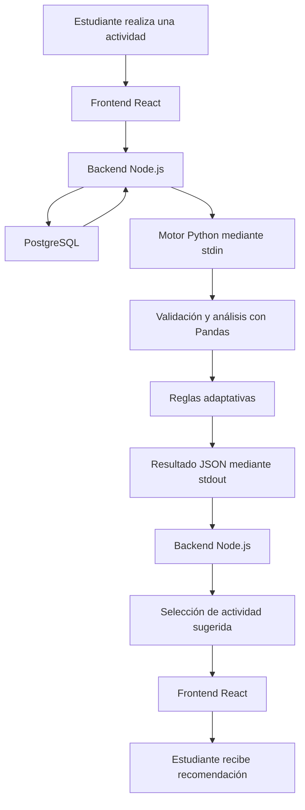

# Integración del Motor de Aprendizaje Adaptativo

## 1. Descripción

Este documento describe el funcionamiento técnico, el contrato de comunicación y la integración del motor adaptativo con los demás componentes de la plataforma.

El motor está desarrollado en Python y utiliza Pandas para analizar las interacciones académicas de los estudiantes. Las recomendaciones se generan mediante reglas determinísticas basadas en el rendimiento y comportamiento registrado.

## 2. Arquitectura de integración

La plataforma está compuesta por cuatro componentes principales:

| Componente | Tecnología | Responsabilidad |
|---|---|---|
| Frontend | React y TypeScript | Interacción con los usuarios y presentación de resultados. |
| Backend | Node.js y Express | Gestión de solicitudes, autenticación, lógica de negocio e integración. |
| Base de datos | PostgreSQL | Almacenamiento de información académica. |
| Motor adaptativo | Python y Pandas | Análisis del comportamiento y generación de recomendaciones. |

El motor Python no establece conexiones directas con PostgreSQL ni expone un servidor HTTP independiente.

El backend es responsable de consultar los datos académicos, preparar la entrada JSON, ejecutar el motor y procesar su respuesta.

## 3. Flujo de integración



El backend puede seleccionar una actividad concreta utilizando la dificultad recomendada por Python y las actividades disponibles en la base de datos.

## 4. Archivos principales

### Motor adaptativo

| Archivo | Responsabilidad |
|---|---|
| main.py | Punto de entrada y comunicación JSON. |
| engine.py | Coordinación del procesamiento. |
| analysis/analyzer.py | Validación y cálculo de métricas. |
| rules/adaptation_rules.py | Aplicación de reglas adaptativas. |
| tests/test_engine.py | Pruebas automatizadas. |
| data/estudiante_prueba.json | Datos de ejemplo. |
| requirements.txt | Dependencias de Python. |

### Integración desde el backend

| Archivo | Responsabilidad |
|---|---|
| engineClient.js | Ejecución del proceso Python e intercambio JSON. |
| engineSafe.js | Manejo de errores del motor desde el backend. |
| studentLearningService.js | Coordinación de la recomendación académica. |
| studentLearningModel.js | Consulta de información académica. |
| studentRecommendation.dto.js | Transformación de datos entre componentes. |
| actividadSelector.js | Selección de una actividad según la dificultad recomendada. |

## 5. Contrato de entrada

El motor recibe un objeto JSON que contiene el identificador del estudiante, el tema evaluado y una lista de interacciones académicas.

### Ejemplo de entrada

```json
{
  "student_id": 1,
  "topic": "SQL JOIN",
  "interactions": [
    {
      "study_minutes": 18,
      "errors": 4,
      "attempts": 3,
      "repetitions": 2,
      "navigation_count": 8,
      "score_percentage": 45
    }
  ]
}
```

### Campos principales

| Campo | Descripción |
|---|---|
| student_id | Identificador del estudiante. |
| topic | Tema académico evaluado. |
| interactions | Lista de interacciones académicas. |

### Campos de cada interacción

| Campo | Tipo esperado | Descripción |
|---|---|---|
| study_minutes | Numérico | Tiempo de estudio registrado en minutos. |
| errors | Entero | Cantidad de errores registrados. |
| attempts | Entero | Cantidad de intentos realizados. |
| repetitions | Entero | Cantidad de repeticiones. |
| navigation_count | Entero | Indicador de navegación. |
| score_percentage | Numérico | Calificación porcentual obtenida. |

Todos los campos indicados deben estar presentes.

Los valores numéricos deben ser finitos y respetar los siguientes rangos:

- study_minutes: mayor o igual a 0.
- errors: entero mayor o igual a 0.
- attempts: entero mayor o igual a 1.
- repetitions: entero mayor o igual a 0.
- navigation_count: entero mayor o igual a 0.
- score_percentage: valor comprendido entre 0 y 100.

Los campos de conteo no admiten valores fraccionarios. Ningún campo numérico admite valores booleanos.

## 6. Procesamiento de información

El motor realiza las siguientes operaciones:

1. Recibe la información en formato JSON.
2. Comprueba la estructura principal.
3. Verifica los campos obligatorios.
4. Valida los valores de cada interacción.
5. Procesa las interacciones mediante Pandas.
6. Calcula el perfil académico.
7. Evalúa las reglas adaptativas.
8. Genera una recomendación personalizada.
9. Devuelve el resultado en formato JSON.

## 7. Métricas calculadas

| Métrica | Descripción |
|---|---|
| average_score | Promedio de calificaciones porcentuales. |
| total_errors | Suma de los errores registrados. |
| average_attempts | Promedio de intentos. |
| total_repetitions | Suma de las repeticiones. |
| average_study_minutes | Promedio de minutos de estudio. |
| total_interactions | Cantidad de interacciones procesadas. |

Estas métricas conforman el perfil académico utilizado para generar las recomendaciones.

No todas las métricas calculadas intervienen directamente en las reglas adaptativas actuales.

## 8. Reglas adaptativas

Las reglas se evalúan en el siguiente orden:

### 8.1 Reforzar contenido

Acción: `reinforce_topic`

Dificultad: `reduced`

Se aplica cuando se cumple al menos una de las siguientes condiciones:

- Promedio de calificaciones inferior a 60 %.
- Errores acumulados iguales o superiores a 5.

El motor recomienda reforzar el tema mediante explicaciones y ejercicios guiados.

### 8.2 Aumentar dificultad

Acción: `increase_difficulty`

Dificultad: `increased`

Se aplica cuando se cumplen simultáneamente las siguientes condiciones:

- Promedio de calificaciones igual o superior a 85 %.
- Errores acumulados iguales o inferiores a 2.
- Promedio de intentos igual o inferior a 2.

El motor recomienda realizar ejercicios de mayor dificultad.

### 8.3 Mantener dificultad

Acción: `maintain_difficulty`

Dificultad: `current`

Se aplica cuando no se cumplen las condiciones anteriores.

El motor recomienda mantener el nivel actual y continuar evaluando el progreso.

### 8.4 Material complementario

Cuando la acción es `reinforce_topic` y el estudiante registra cinco repeticiones o más, el motor añade una sugerencia de material complementario con una explicación diferente.

Esta condición modifica el mensaje de recomendación, pero no cambia la acción adaptativa principal.

## 9. Contrato de salida

El motor devuelve un objeto JSON con dos propiedades principales:

- `profile`: perfil académico calculado.
- `recommendation`: resultado de las reglas adaptativas.

### Ejemplo de salida

```json
{
  "profile": {
    "student_id": 1,
    "topic": "SQL JOIN",
    "average_score": 45.0,
    "total_errors": 4,
    "average_attempts": 3.0,
    "total_repetitions": 2,
    "average_study_minutes": 18.0,
    "total_interactions": 1
  },
  "recommendation": {
    "student_id": 1,
    "topic": "SQL JOIN",
    "action": "reinforce_topic",
    "difficulty": "reduced",
    "reason": "Puntuación promedio: 45.0%; errores acumulados: 4; intentos promedio: 3.0.",
    "recommendation": "Se recomienda reforzar el tema SQL JOIN con explicaciones y ejercicios guiados."
  }
}
```

### Campos de la recomendación

| Campo | Descripción |
|---|---|
| student_id | Identificador del estudiante. |
| topic | Tema evaluado. |
| action | Acción adaptativa seleccionada. |
| difficulty | Dificultad recomendada. |
| reason | Justificación basada en las métricas. |
| recommendation | Mensaje dirigido al estudiante. |

## 10. Comunicación con Node.js

El backend ejecuta el archivo `main.py` mediante un proceso Python utilizando el argumento `--stdin`.

La comunicación se realiza mediante:

- stdin: recepción del objeto JSON.
- stdout: devolución del resultado JSON.
- stderr: comunicación de errores controlados.
- Código de salida: identificación del resultado de la ejecución.

El backend interpreta la respuesta y transforma los datos al formato utilizado por el frontend.

### Transformación de la respuesta

Aunque Python devuelve el perfil académico y la recomendación completa, engineClient.js extrae los siguientes campos:

- student_id
- topic
- action
- difficulty
- recommendation

El backend calcula nuevamente el promedio de calificaciones, los errores acumulados y el promedio de intentos mediante studentRecommendation.dto.js.

Estas métricas se presentan al frontend como mastery, errors y attempts, respectivamente.

El backend también incorpora la actividad sugerida cuando se encuentra disponible.


```http
POST /api/mis-inscripciones/:inscripcionId/temas/:temaId/recomendacion
```

La solicitud se procesa mediante el backend, que obtiene las interacciones académicas correspondientes al estudiante y al tema solicitado.

El frontend no necesita enviar directamente al motor las métricas académicas.

## 11. Configuración del entorno

El motor utiliza el entorno virtual de Python ubicado en la carpeta principal del repositorio.

### Instalación inicial

```powershell
python -m venv .venv
.\.venv\Scripts\Activate.ps1
python -m pip install -r adaptive-engine/requirements.txt
```

### Configuración del backend

El backend contempla las siguientes variables relacionadas con Python:

```env
PYTHON_EXECUTABLE=
PYTHONUTF8=1
PYTHONIOENCODING=utf-8
```

La variable `PYTHON_EXECUTABLE` permite indicar explícitamente el ejecutable de Python cuando sea necesario.

En Windows puede utilizarse el ejecutable del entorno virtual:

```text
.venv/Scripts/python.exe
```

La ruta debe resolverse correctamente desde el entorno de ejecución del backend.

No deben publicarse credenciales ni archivos de configuración que contengan información sensible.

## 12. Ejecución independiente

Desde la carpeta principal del repositorio:

```powershell
cd adaptive-engine
python main.py
```

El comando procesa el archivo de ejemplo incluido en el módulo.

### Ejecución mediante stdin

En PowerShell:

```powershell
$OutputEncoding = [System.Text.UTF8Encoding]::new($false)
$OutputEncoding = [System.Text.UTF8Encoding]::new($false)
Get-Content .\data\estudiante_prueba.json -Raw -Encoding UTF8 | python -X utf8 main.py --stdin

Esta modalidad reproduce el mecanismo de comunicación utilizado por Node.js.

## 13. Integración de actividades sugeridas

La migración 009 de PostgreSQL incorpora la clasificación de actividades mediante tres niveles de dificultad: BAJA, MEDIA y ALTA.

El backend utiliza la dificultad recomendada por Python para calcular un nivel objetivo tomando como referencia la dificultad de una actividad anterior.

| Dificultad de referencia | reduced | current | increased |
|---|---|---|---|
| BAJA | BAJA | BAJA | MEDIA |
| MEDIA | BAJA | MEDIA | ALTA |
| ALTA | MEDIA | ALTA | ALTA |

El ajuste se mantiene dentro de los tres niveles disponibles.

### Criterios de selección

El selector de actividades aplica los siguientes criterios de prioridad:

1. Preferir una actividad diferente de la actividad de referencia.
2. Seleccionar la actividad más cercana al nivel objetivo.
3. Preferir el nivel inferior cuando existe un empate de distancia.
4. Utilizar el identificador de la actividad como criterio final de desempate.

La actividad seleccionada puede tener una dificultad diferente del nivel objetivo cuando no existe una candidata más apropiada.

### Información de la actividad sugerida

El backend puede devolver los siguientes campos:

| Campo | Descripción |
|---|---|
| actividadId | Identificador de la actividad seleccionada. |
| titulo | Título de la actividad. |
| dificultad | Dificultad real de la actividad seleccionada. |
| dificultadObjetivo | Nivel de dificultad calculado como objetivo. |
| coincideNivel | Indica si la dificultad seleccionada coincide con el objetivo. |
| esRepeticion | Indica si se seleccionó nuevamente la actividad de referencia. |
| actividadReferenciaId | Identificador de la actividad utilizada como referencia. |

Cuando no existe una referencia clasificada, no hay actividades candidatas o se produce un error durante la selección, actividadSugerida devuelve null.

La ausencia de una actividad sugerida no impide devolver la recomendación adaptativa principal.

El frontend presenta la actividad sugerida cuando está disponible y permite al estudiante iniciar su práctica.

El motor Python no selecciona directamente las actividades, no modifica la base de datos y no inicia evaluaciones automáticamente.


## 14. Validaciones y manejo de errores

El motor valida:

- Estructura principal del JSON.
- Presencia de student_id y topic.
- Existencia de una lista de interacciones no vacía.
- Estructura de cada interacción.
- Presencia de campos obligatorios.
- Valores numéricos y rangos permitidos.
- Rechazo de booleanos en campos numéricos.
- Rechazo de fracciones en campos de conteo.
- Rechazo de NaN, Infinity y -Infinity.

Cuando se produce un error controlado en modo stdin, el motor devuelve un objeto JSON por stderr.

Ejemplo:

```json
{
  "error": "El campo errors no admite valores booleanos."
}
```

El proceso termina con código de salida 1.

El backend gestiona los errores de integración y puede devolver los siguientes estados:

| Estado HTTP | Situación |
|---|---|
| 404 | No existen intentos calificados para generar la recomendación. |
| 502 | Error durante la ejecución o comunicación con el motor Python. |

## 15. Pruebas automatizadas

Desde la carpeta adaptive-engine:

```powershell
python -m unittest discover -s tests -v
```

### Resultados registrados

| Tipo de validación | Casos | Aprobados | Fallidos |
|---|---:|---:|---:|
| Pruebas propias del motor | 20 | 20 | 0 |
| Casos independientes de QA | 54 | 54 | 0 |

Las pruebas propias incluyen escenarios de rendimiento bajo, medio y alto, validaciones de datos y ejecución mediante stdin.

El reporte independiente de QA del 24 de noviembre de 2026 confirma la aprobación de los 54 casos correspondientes al módulo Python.

Estos resultados representan dos conjuntos de pruebas y no deben interpretarse necesariamente como 74 casos únicos.

## 16. Incidencias corregidas

| Incidencia | Descripción | Estado |
|---|---|---|
| INC-03 | Estructura principal del JSON. | Corregida |
| INC-04 | Valores numéricos no finitos. | Corregida |
| INC-05 | Campos student_id y topic. | Corregida |
| INC-06 | Booleanos en campos numéricos. | Corregida |
| INC-07 | Valores fraccionarios en campos enteros. | Corregida |

Las correcciones fueron incorporadas mediante el Pull Request #21, conservando las reglas adaptativas y el contrato JSON.

## 17. Escenarios de validación funcional

Los siguientes escenarios representan resultados esperados según las reglas implementadas.

| Escenario | Promedio | Errores | Intentos promedio | Repeticiones | Acción esperada |
|---|---:|---:|---:|---:|---|
| Rendimiento bajo | 45 | 4 | 3 | 2 | reinforce_topic |
| Rendimiento medio | 75 | 3 | 2 | 2 | maintain_difficulty |
| Rendimiento alto | 95 | 1 | 1 | 1 | increase_difficulty |
| Errores acumulados | 90 | 5 | 2 | 3 | reinforce_topic |
| Refuerzo complementario | 50 | 6 | 3 | 5 | reinforce_topic |

Estos escenarios sirven como referencia para las pruebas de integración y demostración del sistema.

No representan resultados obtenidos de los 15 participantes.

## 18. Limitaciones técnicas

- El motor utiliza reglas determinísticas y no modelos entrenados de aprendizaje automático.
- Las recomendaciones dependen de los datos disponibles.
- Los errores se consideran de manera acumulativa.
- El tiempo de estudio representa tiempo transcurrido y no necesariamente atención activa.
- El indicador de navegación no interviene en las decisiones adaptativas actuales.
- La disponibilidad de actividades sugeridas depende del backend y la base de datos.
- Los umbrales adaptativos implementados no constituyen por sí mismos una validación científica de eficacia pedagógica.
- El cliente de integración de Node.js no establece explícitamente un tiempo máximo de ejecución del proceso Python.
- Las métricas presentadas por el backend se calculan nuevamente a partir de las interacciones, por lo que debe mantenerse la consistencia entre ambos componentes.


## 19. Estado de integración

### Implementado

- Procesamiento y validación de información JSON.
- Análisis académico mediante Pandas.
- Cálculo del perfil del estudiante.
- Reglas adaptativas.
- Generación de recomendaciones.
- Comunicación con Node.js.
- Procesamiento de información procedente de PostgreSQL.
- Manejo controlado de errores.
- Pruebas automatizadas.
- Corrección de incidencias del motor.
- Integración de recomendaciones con actividades sugeridas mediante el backend.

### Validaciones finales del proyecto

- Ejecución integral de la plataforma en el entorno definitivo.
- Comprobación de los escenarios adaptativos desde el frontend.
- Participación en las pruebas con usuarios.
- Registro de los resultados finales de integración.

## 20. Conclusión

El motor adaptativo constituye el componente responsable de analizar el comportamiento académico y generar recomendaciones personalizadas dentro de la plataforma.

Su integración mediante JSON permite mantener separadas las responsabilidades de Python, Node.js, PostgreSQL y React.

La arquitectura facilita el mantenimiento del sistema y permite incorporar futuras estrategias de adaptación sin modificar completamente los demás componentes.
