# Evidencias del Avance 4

**Pruebas iniciales:** 15 de noviembre de 2026 · **Ampliación del recorrido:** 17 de noviembre de 2026 · **Entorno:** PostgreSQL local (`proyectofinal_db`), API en `localhost:3000` y frontend en `localhost:5173`.

**Versiones:** las pruebas iniciales corresponden a backend `16984a5` y frontend `6a02462`. El recorrido del 17 de noviembre se realizó después de actualizar ambas copias a `origin/main`; la revisión de referencia del repositorio fue `c97e2b76418c0982b03136447641d4039587814f` (incluye PR #16 y #17). No se adjuntó la salida local de `git log` de esas dos copias; ese SHA es la referencia revisada, no una certificación independiente de los procesos en ejecución. Los IDs son del entorno local y pueden variar.

## Alcance y lectura de la evidencia

Este informe reúne resultados compartidos por el responsable de BD, capturas de la aplicación y comprobaciones de PostgreSQL. Se conservan las pruebas históricas: los nuevos intentos cambian el estado de la demo y no invalidan los valores iniciales.

- **Aprobado:** resultado respaldado por la salida o captura indicada.
- **Observado sin adjunto:** resultado comunicado durante la prueba, sin una transcripción o imagen conservada para ese caso.
- **Abierto:** diferencia o decisión que aún requiere corrección o aclaración del equipo.

El recorrido de evaluación, persistencia, calificación y recomendación se demostró en el entorno local. No se afirma ausencia de defectos ni cobertura completa de QA, de permisos HTTP de todas las rutas o de concurrencia entre sesiones.

## Recomendaciones por API

Sesión de estudiante demo (ID local `5`). Se envió una solicitud `POST /api/students/5/recommendation` con el nombre del tema en `topic`, usando los intentos calificados del seed.

### Cómo reproducir la prueba

1. Usar la base local `proyectofinal_db` con las migraciones aplicadas y los datos iniciales de `database/seeds/datos_prueba_integracion_resultados.sql`. Si el seed ya está cargado, no es necesario volver a ejecutarlo. Usar una base de prueba aparte si los resultados iniciales ya cambiaron.
2. Arrancar Express desde `backend`. Si en Windows la recomendación devuelve caracteres como `�`, iniciar el servidor con esta configuración de PowerShell:

   ```powershell
   $env:PYTHONIOENCODING = 'utf-8'
   npm start
   ```

   Si Express ya estaba en ejecución, reiniciarlo desde esa misma terminal. Esta configuración afecta la salida de Python; no requiere modificar PostgreSQL ni el seed.
3. Iniciar sesión como estudiante demo y solicitar una recomendación por cada tema de la tabla con el JSON `{"topic":"SQL JOIN"}`, cambiando el valor de `topic` para los otros dos casos. Usar el ID de la sesión del estudiante; el `5` es el ID local de esta evidencia.
4. Para reproducir la captura, arrancar React con `VITE_USE_MOCK=false` y `VITE_API_URL=http://localhost:3000/api`, abrir el ejercicio de SQL JOIN y solicitar la recomendación. Tomar la captura antes de calificar la evaluación pendiente de SQL JOIN: un intento adicional puede cambiar las cifras del seed.

### Resultados de referencia

| Caso | Tema | Acción esperada y observada | Dificultad | Dominio | Errores | Intentos promedio | Estado |
|---|---|---|---|---:|---:|---:|---|
| A4-REC-01 | SQL JOIN | `reinforce_topic` | `reduced` | 16.7 % | 10 | 2.0 | Aprobado |
| A4-REC-02 | SQL WHERE | `maintain_difficulty` | `current` | 66.7 % | 4 | 2.0 | Aprobado |
| A4-REC-03 | SQL SELECT | `increase_difficulty` | `increased` | 91.7 % | 1 | 2.0 | Aprobado |

`attempts` en la respuesta es el promedio de los números de intento, no el total. Este backend consulta por nombre de tema; la prueba no valida que Express utilice el filtro por inscripción y tema de la migración 008.

<details>
<summary>Respuestas JSON observadas</summary>

```json
[
  {
    "success": true,
    "recommendation": {
      "studentId": 5,
      "tema": "SQL JOIN",
      "accion": "reinforce_topic",
      "dificultad": "reduced",
      "recomendacion": "Se recomienda reforzar el tema SQL JOIN con explicaciones y ejercicios guiados.",
      "mastery": 16.7,
      "errors": 10,
      "attempts": 2
    }
  },
  {
    "success": true,
    "recommendation": {
      "studentId": 5,
      "tema": "SQL WHERE",
      "accion": "maintain_difficulty",
      "dificultad": "current",
      "recomendacion": "Se recomienda mantener el nivel de SQL WHERE y continuar evaluando el progreso.",
      "mastery": 66.7,
      "errors": 4,
      "attempts": 2
    }
  },
  {
    "success": true,
    "recommendation": {
      "studentId": 5,
      "tema": "SQL SELECT",
      "accion": "increase_difficulty",
      "dificultad": "increased",
      "recomendacion": "El estudiante muestra buen desempeño en SQL SELECT. Se recomienda probar ejercicios más difíciles.",
      "mastery": 91.7,
      "errors": 1,
      "attempts": 2
    }
  }
]
```

</details>

### A4-REC-04 — Sin resultados calificados

Con la misma sesión se envió:

```json
{"topic":"QA-AVANCE4-SIN-INTENTOS"}
```

**Resultado esperado y observado: HTTP 404.**

```json
{"success":false,"message":"El estudiante no tiene intentos calificados en ese tema"}
```

El nombre se eligió como un tema inexistente. El endpoint de esa versión no distingue ese caso de un tema existente sin intentos calificados. Se verificó la respuesta de la API, no el manejo del mensaje en React.

## A4-UI-01 — Tarjeta de SQL JOIN en React

**Aprobado.** En `6a02462` la tarjeta mostró **16.7 % de dominio**, **10 errores acumulados** y **2.0 intentos promedio**, coincidiendo con la API. También mostró la recomendación de reforzar el tema y la dificultad reducida.

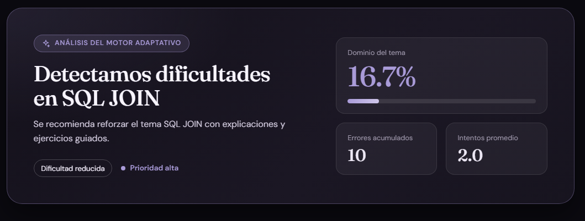

Esta captura histórica demuestra la visualización de una recomendación basada en intentos del seed. El recorrido con intentos guardados desde React se documenta por separado en la ampliación del 17 de noviembre.

## CRUD de cursos por API

Curso de prueba: `QA-A4-20261115-012204` (ID local `14`).

| Caso | Rol | Solicitud | Resultado observado | Estado |
|---|---|---|---|---|
| A4-CUR-01 | Administrador | `POST /api/cursos` | `success: true`; curso creado en borrador | Aprobado |
| A4-CUR-02 | Administrador | `GET /api/cursos/14` | `success: true`; devolvió el curso creado | Aprobado |
| A4-CUR-03 | Administrador | `PUT /api/cursos/14` | `success: true`; nombre cambiado a «Curso temporal QA editado» | Aprobado |
| A4-CUR-04 | Administrador | `PATCH /api/cursos/14/estado` con `{"estado":"ARCHIVADO"}` | `success: true`; estado confirmado en PostgreSQL | Aprobado |
| A4-CUR-05 | Docente | `POST /api/cursos` con un código distinto, terminado en `-DOC` | HTTP 403; no se creó el curso | Aprobado |

Consulta de verificación:

```sql
SELECT id, codigo, nombre, estado
FROM public.cursos
WHERE codigo IN ('QA-A4-20261115-012204', 'QA-A4-20261115-012204-DOC');
```

```text
 id |        codigo         |          nombre           |  estado
----+-----------------------+---------------------------+-----------
 14 | QA-A4-20261115-012204 | Curso temporal QA editado | ARCHIVADO
(1 row)
```

## CRUD de módulos y temas por API — resultado observado

En el backend `16984a5`, con el docente autorizado en `DEMO-006`, se observó que la API permitió crear, consultar, editar, publicar, devolver a borrador y eliminar los módulos y temas temporales. El listado reflejó los cambios de `totalTemas` y conservó el módulo original tras la limpieza.

La API rechazó con HTTP 409 la eliminación de un tema publicado y la de un módulo que todavía tenía temas. También rechazó con HTTP 403 la creación de un módulo por un estudiante y la consulta y creación de módulos por el docente en un curso donde no era editor.

Estado de este apartado: **observado sin adjunto**. Resume las salidas compartidas durante la prueba. No se adjuntan capturas ni transcripciones de esas solicitudes. El CRUD completo de módulos/temas desde React no se verificó con esa prueba; la ampliación siguiente sí conserva el selector docente y la lectura de contenido.

## Recorrido integrado del 17 de noviembre

### A4-UI-02 — Selector del docente

**Aprobado para la carga observada.** La sesión docente mostró `DEMO-006 · Curso de gestion docente` en el selector, sin introducir manualmente su ID, y cargó `Modulo de prueba`, un tema y estado BORRADOR. La captura no demuestra por sí sola que todas las asignaciones ajenas se excluyan; las restricciones SQL se verificaron en las pruebas de 008 y el rechazo a curso ajeno se observó anteriormente por API.

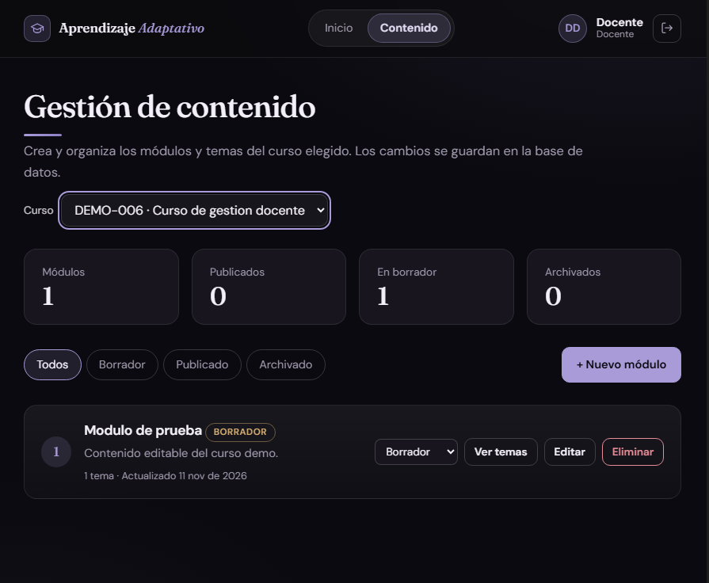

### A4-UI-03 — Contenido real del estudiante

**Aprobado.** La sesión estudiante mostró el curso `DEMO-SQL-007`, módulo `Consultas SQL`, temas `SQL SELECT`, `SQL WHERE` y `SQL JOIN`, y las dos actividades del último tema: práctica y evaluación disponible.

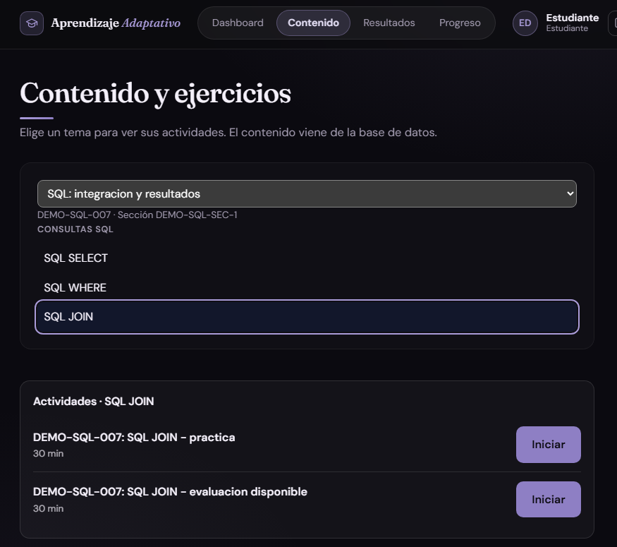

### A4-E2E-01 — Cuestionario, entrega y calificación

**Aprobado en el recorrido observado.** Se abrió la evaluación `DEMO-SQL-007: SQL JOIN - evaluacion disponible`, se respondieron las cuatro preguntas desde React y se entregó. La interfaz mostró **100 % — 40 de 40 puntos**. Antes de este envío ya existía un primer intento de **20/40 (50 %)**: no se tomó la evaluación como una actividad sin historial.

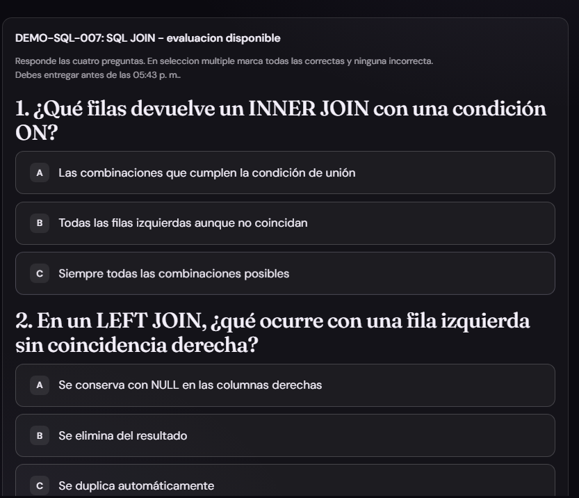

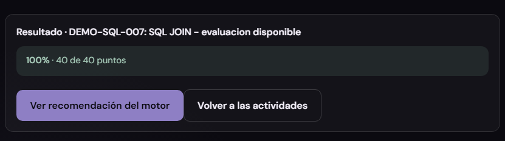

La captura del cuestionario solo muestra parte de las preguntas. La ausencia de `es_correcta` y `explicacion` en la respuesta de la función fue probada en 007; no se inspeccionó aquí un JSON de red del cuestionario para afirmar una comprobación HTTP adicional de esos campos.

### A4-DB-01 — Persistencia confirmada en PostgreSQL

Consulta ejecutada por el responsable en `proyectofinal_db`:

```sql
SELECT
    it.id AS intento_id,
    it.numero_intento,
    it.estado,
    it.puntaje_obtenido,
    it.puntaje_maximo,
    it.entregado_en,
    it.calificado_en,
    COUNT(r.id) AS respuestas,
    COUNT(r.id) FILTER (
        WHERE r.calificado_en IS NOT NULL
    ) AS respuestas_calificadas,
    SUM(r.puntaje_obtenido) AS suma_puntajes
FROM public.intentos it
JOIN public.inscripciones i ON i.id = it.inscripcion_id
JOIN public.usuarios u ON u.id = i.estudiante_id
JOIN public.actividades a ON a.id = it.actividad_id
LEFT JOIN public.respuestas r ON r.intento_id = it.id
WHERE u.email = 'estudiante.demo@example.com'
  AND a.titulo = 'DEMO-SQL-007: SQL JOIN - evaluacion disponible'
GROUP BY it.id
ORDER BY it.id DESC;
```

| Intento local | Número | Estado | Puntaje | Respuestas | Calificadas | Suma de puntajes |
|---|---:|---|---|---:|---:|---:|
| 30 | 2 | CALIFICADO | 40/40 | 4 | 4 | 40 |
| 29 | 1 | CALIFICADO | 20/40 | 4 | 4 | 20 |

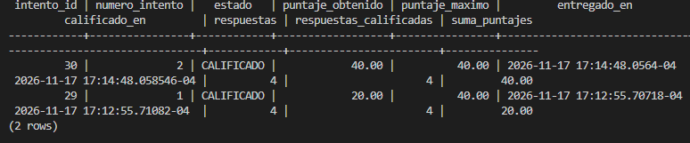

Se conservó el primer intento; no se borraron datos ni se reinició el seed para obtener el resultado esperado.

### A4-E2E-02 — Recomendación posterior al nuevo resultado

**Aprobado en la interfaz.** Después de entregar, se solicitó la recomendación y React mostró `reinforce_topic`, dificultad reducida, **40 %**, **12 errores** y **1.8 intentos promedio**. Los indicadores cambiaron respecto al escenario inicial de 16.7 %, 10 y 2.0.

| Indicador | Cálculo con el historial de SQL JOIN |
|---|---|
| Promedio del motor | `(0 + 25 + 25 + 50 + 100) / 5 = 40 %` |
| Errores acumulados | `10 + 2 + 0 = 12` |
| Intentos promedio | `(1 + 2 + 3 + 1 + 2) / 5 = 1.8` |

Los números de intento reinician por actividad e inscripción: no son una secuencia única de todo el tema. La recomendación puede seguir siendo de refuerzo aunque el último intento tenga 100 %, porque considera el historial del tema.

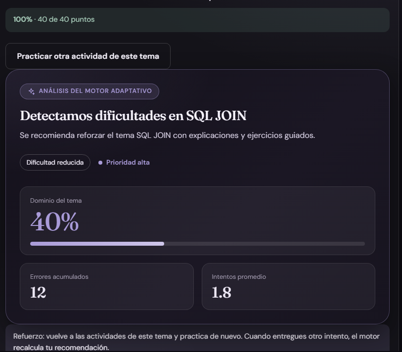

La revisión del código de `c97e2b7` confirmó el uso de `listar_interacciones_motor_estudiante(actor, inscripcionId, temaId)` por el nuevo endpoint `POST /api/mis-inscripciones/:inscripcionId/temas/:temaId/recomendacion`. La captura corresponde al flujo nuevo desde la interfaz; no se adjuntó su intercambio completo de red. Las tres respuestas JSON históricas de este documento pertenecen al endpoint anterior por nombre y no deben presentarse como capturas del nuevo contrato.

### A4-UI-04 — Resultados y presentación del promedio

La evaluación mostró **75 % con dos intentos**, coherente con `(50 + 100) / 2`. La pantalla general mostró un promedio de 67 % y seis elementos, pero incluye prácticas: esa agregación queda observada con las incidencias de clasificación que se detallan abajo; no se certifica como nota académica global.

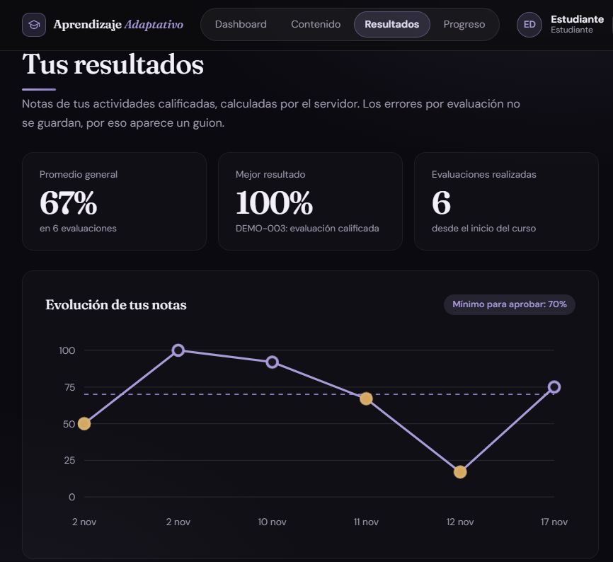

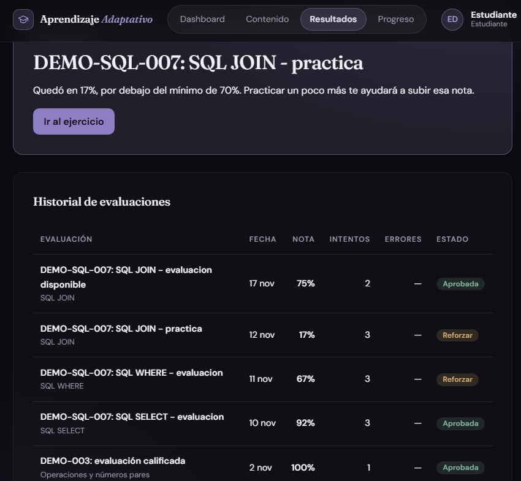

### A4-UI-05 — Pantalla de progreso y recomendación

Se observaron datos de minutos por día, rendimiento por tema y la recomendación de SQL JOIN. La pantalla mostró 45.8 % para ese tema mientras la tarjeta del motor mostró 40 %. El cálculo explica la diferencia, pero las etiquetas necesitan aclaración. El gráfico de horas presenta un defecto de decimales y no se certificó aquí contra el detalle SQL completo de minutos.

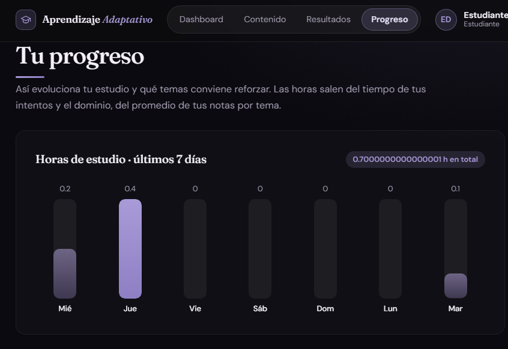

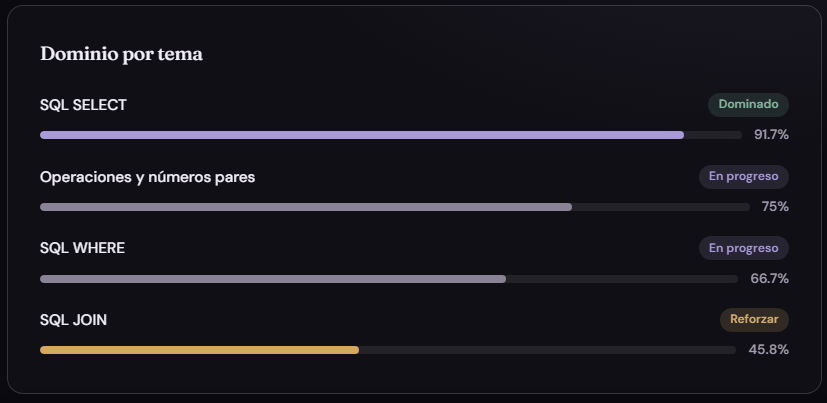

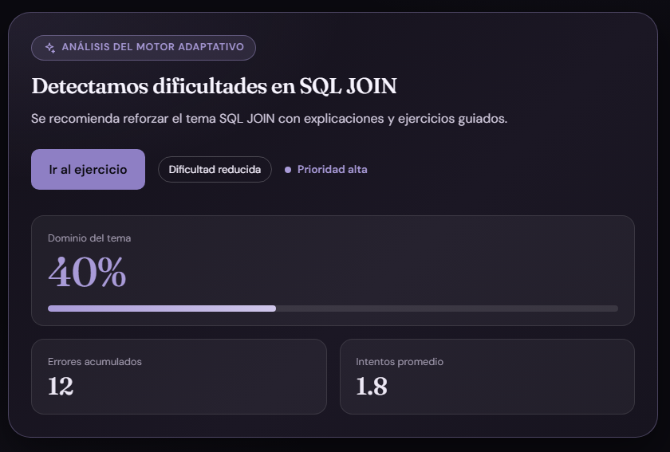

## Incidencias y decisiones abiertas

Hallazgos observados el 17 de noviembre. No se registraron cambios al esquema para resolverlos. Los responsables indicados son sugeridos para coordinación, no asignaciones confirmadas.

| ID | Observación y reproducción | Impacto | Responsable sugerido | Cierre esperado | Estado |
|---|---|---|---|---|---|
| A4-INC-01 | Tras los intentos 29 y 30, Progreso muestra SQL JOIN en 45.8 %; la recomendación muestra 40 %. | Ambigüedad del indicador llamado dominio. | Frontend, backend y motor | Acordar o distinguir fórmulas y etiquetas; comparar nuevamente contra el historial. | Abierto |
| A4-INC-02 | Resultados incluye actividades PRACTICA en «Historial de evaluaciones», en el contador y en el promedio general. | Puede confundirse práctica con nota académica. | Frontend y backend | Filtrar EVALUACION para nota académica o renombrar el conjunto como resultados de actividades, diferenciando finalidades. | Abierto |
| A4-INC-03 | La pantalla muestra «Mínimo para aprobar: 70 %» como valor fijo del frontend. | Se presenta una política académica no confirmada por el equipo. | Equipo y frontend | Confirmar el criterio o retirar/reformular el texto; no añadirlo al SQL sin acuerdo. | Por acordar |
| A4-INC-04 | En Progreso aparece `0.7000000000000001 h en total`. El servicio redondea por día antes de sumar. | Formato defectuoso y posible pérdida de precisión de la suma. | Frontend | Sumar minutos originales antes de convertir a horas, formatear el total y comprobar contra la API. Etiquetar el dato como tiempo transcurrido en intentos. | Abierto |

Fórmulas de A4-INC-01, verificadas contra el código de esa versión:

- Progreso usa un promedio por actividad: `(16.67 + 75) / 2 = 45.835`, mostrado como 45.8 %.
- El motor usa un promedio por intento: `(0 + 25 + 25 + 50 + 100) / 5 = 40 %`.
- La finalización de 008 cuenta actividades con al menos un intento calificado: sería 2 de 2 (100 %) para SQL JOIN. Es otro indicador; no se adjuntó una consulta o pantalla de ese valor en esta sesión.

La tabla reúne diferencias de interfaz y decisiones semánticas; no prueba un error en la persistencia de PostgreSQL. La finalización no implica aprobación ni dominio. `navigation_count=0` continúa siendo dato no medido y los minutos representan tiempo transcurrido, no atención o estudio activo.

## Reproducción del recorrido nuevo y conservación de datos

1. Registrar los commits de las dos copias locales, los puertos y la cuenta de conexión de Express sin publicar secretos. No reinstalar migraciones que ya finalizaron.
2. Entrar con el docente demo y comprobar el selector de DEMO-006. Salir y entrar con el estudiante demo, seleccionar DEMO-SQL-007 y SQL JOIN.
3. Registrar el historial previo de la evaluación. En esta ejecución ya había un intento 20/40; no asumir que el seed sigue intacto después de practicar.
4. Iniciar o retomar un intento propio, responder, entregar y consultar sus respuestas/puntajes en PostgreSQL. No repetir inicio para fabricar la misma evidencia; cada intento nuevo cambia el historial.
5. Pedir la recomendación después de calificar y comparar las métricas con todos los intentos calificados del tema en esa inscripción.
6. Revisar Resultados y Progreso. Los IDs 29 y 30 son evidencia histórica local, no parámetros fijos para otros entornos.

Para repetir exactamente los valores iniciales del seed usar otra base de validación. No borrar intentos, editar notas ni mover sus fechas para que coincidan con una captura. Reejecutar el seed ampliado no elimina los nuevos intentos ni restaura los promedios originales.

## Cierre y alcance pendiente

- **Demostrado:** selector docente con su curso asignado, lectura del contenido del estudiante, cuestionario, entrega y calificación, persistencia de cuatro respuestas por intento, nueva recomendación y reflejo de la evaluación en Resultados.
- **Con incidencias:** presentación del rendimiento por tema, clasificación de prácticas/evaluaciones, política del 70 % y formato/suma de horas.
- **Pendiente:** registrar los hallazgos en la matriz de Pablo, comunicar las decisiones al equipo y repetir solo las comprobaciones afectadas después de corregirlas. Adjuntar los commits locales y una captura de red del nuevo endpoint mejora la trazabilidad.
- **No cubierto:** pruebas de carga/concurrencia, revisión exhaustiva de permisos de cada ruta, medición de navegación, tiempo activo, historial de recomendaciones ni ajuste automático de dificultad sobre actividades concretas.

El alcance SQL de esta entrega está implementado y validado localmente. Este informe no declara que todo el software esté libre de incidencias ni que cada pantalla o escenario de QA haya sido probado.
